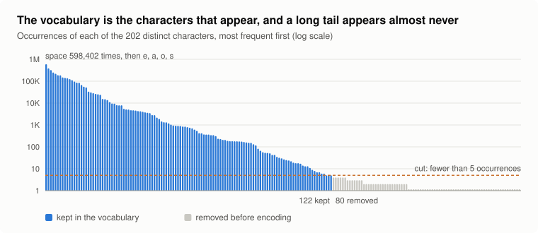
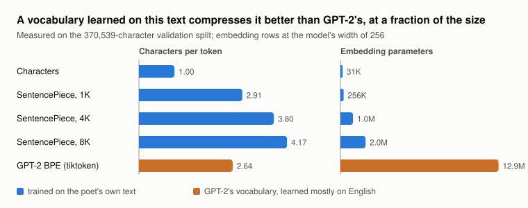
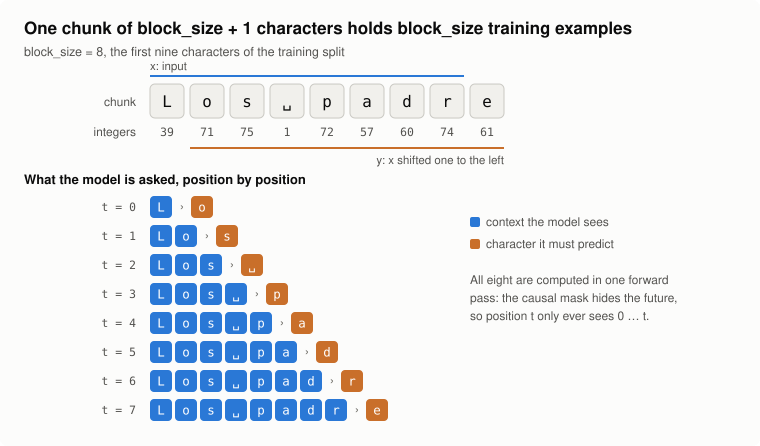
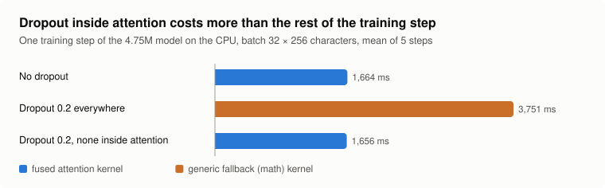
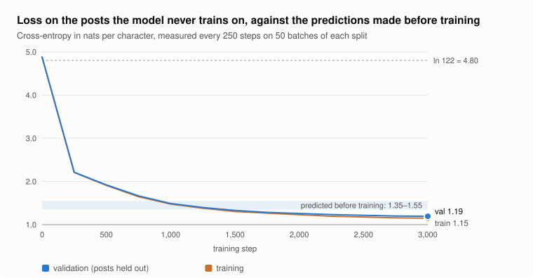
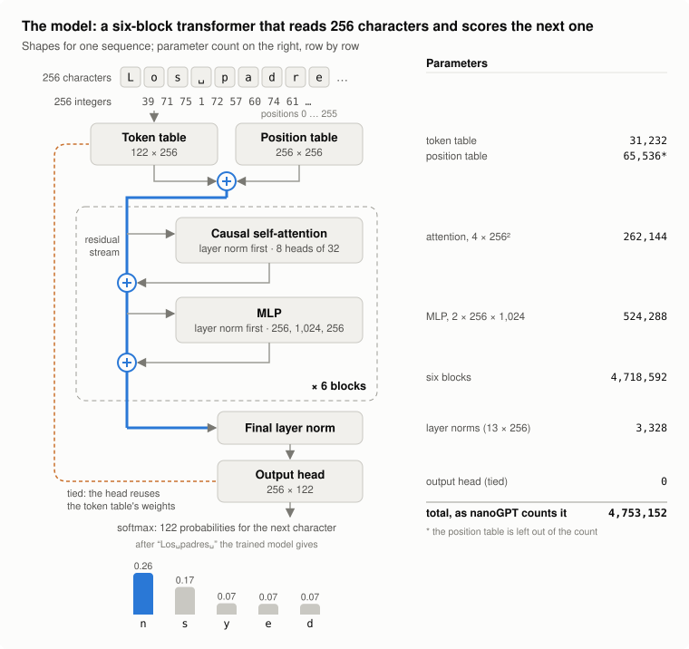

<p align="center">
  <a href="https://infraphysics.net/blog/bits2bricks/predicted-and-measured-costs-of-a-character-level-transformer"></a>
</p>

<h1 align="center">poet-gpt</h1>

<p align="center">
  A character-level GPT trained from scratch on a laptop CPU, on the posts of one of my favourite poets.<br>
  nanoGPT with one line changed, and every cost predicted before the run and checked after it.
</p>

<p align="center">
  <a href="LICENSE"></a>
  <a href="https://github.com/karpathy/nanoGPT"></a>
  
</p>

<p align="center">
  <b>A side project of <a href="https://infraphysics.net">InfraPhysics</a>.</b>
  The full write-up, with the figures and the reasoning, is at
  <a href="https://infraphysics.net/blog/bits2bricks/predicted-and-measured-costs-of-a-character-level-transformer"><b>infraphysics.net</b></a>
</p>

<p align="center">
  
</p>

---

A character-level GPT trained from scratch on a laptop CPU, on 3.6 million characters of public posts by one of my favourite poets (a Spanish writer). It is [nanoGPT](https://github.com/karpathy/nanoGPT) with one line changed, plus the scripts I used to measure everything before training and check it after.

**The corpus and the trained weights are not in this repo.** The texts belong to their author, and a model trained on them can reproduce pieces of them. Point the scripts at any folder of `.txt` files (one document per file) and you get the same pipeline on your own text.

## The idea

I was watching Karpathy's [Let's build GPT: from scratch, in code, spelled out](https://www.youtube.com/watch?v=kCc8FmEb1nY) and paused it at the part where he lists the unique characters of Shakespeare and maps them to integers. I wanted to run the whole thing on text I actually care about, on the only machine I had at hand: a ThinkPad with a Ryzen AI 7 PRO 450 and 64 GB of RAM, no NVIDIA GPU.

The rule was to write every number down before running anything, and then see which predictions survive:

| Prediction | How | Predicted | Measured |
|---|---|---:|---:|
| Loss at step 0 | uniform guess over the vocabulary, ln 122 | 4.80 | 4.88 |
| Length of the run | 10-step benchmark, 24.6M tokens at 6,368 tokens/s, plus evaluation | ~75 min | 2 h 02 min |
| Compute | 6 · N · D = 6 × 4.75M × 24.6M | 7.0e14 FLOPs | same |
| Best validation loss | anchored on nanoGPT's Shakespeare (1.47) | 1.35 to 1.55 | **1.19** |
| Cost | laptop electricity | cents | cents |

## The corpus, measured

| | |
|---|---:|
| posts | 1,976 |
| characters | 3,629,723 |
| words | 647,675 |
| distinct characters | 205 (202 after removing @mentions and #hashtags) |
| characters kept (seen at least 5 times) | 122 |
| train / val (whole posts, seeded shuffle) | 3,240,816 / 370,539 characters |



## Tokenizer: characters, GPT-2, or SentencePiece

Measured on the validation split (`tools/measure_tokenizers.py`):

| Tokenizer | Vocabulary | Characters per token | Embedding params at width 256 |
|---|---:|---:|---:|
| characters (this run) | 122 | 1.00 | 31K |
| SentencePiece BPE trained on the training split | 1,000 | 2.91 | 256K |
| SentencePiece BPE | 4,000 | 3.80 | 1.0M |
| SentencePiece BPE | 8,000 | 4.17 | 2.0M |
| GPT-2 BPE (`tiktoken.get_encoding("gpt2")`) | 50,257 | 2.64 | 12.9M |

GPT-2's merges were learned mostly on English, so on Spanish they compress worse than a 1,000-token vocabulary learned on the text itself, and their embedding table alone would be 2.7 times this whole model. Characters are what the lecture uses, and with this little data every one of the 122 gets plenty of training signal. To compare runs across tokenizers, compare bits per character: loss per token / (characters per token × ln 2).



## The model

nanoGPT's GPT with `n_layer=6, n_head=8, n_embd=256, block_size=256, dropout=0.2`: 4.75M parameters. Training is 3,000 steps of 32 random chunks of 256 characters (8,192 predictions per step), about 7.6 passes over the training text, keeping the checkpoint with the best validation loss. Config: [`config/train_poet_char.py`](config/train_poet_char.py).



## The one line changed: dropout inside attention

The first launch ran at 3.9 s per step against a benchmark of 1.3 s. Evaluation (dropout off) ran at benchmark speed, which pointed at dropout. On a CPU, `scaled_dot_product_attention` refuses its fused kernel when `dropout_p > 0` (`No available kernel`) and falls back to the generic math kernel: one attention call forward and backward goes from 53 ms to 614 ms. So [`model.py`](model.py) calls attention with `dropout_p=0.0`; the residual and MLP dropout stay at 0.2 and cost nothing measurable.



`tools/check_sdpa_kernel.py` reproduces the kernel refusal; `tools/bench_dropout.py`, run against nanoGPT's original `model.py`, reproduces the 2.3× slower step.

## Results



The run ended at step 3,000 with **validation loss 1.1935** (1.72 bits per character) and training loss 1.1496; validation was still falling, so the last checkpoint is the best one. The full log is in [`logs/train.log`](logs/train.log).

Two predictions missed, in opposite directions:

- **The loss beat its band.** The band was anchored on Shakespeare, and the loss per character of Early Modern English verse and of Spanish posts are different quantities. The train/val gap stayed small (0.012 at step 1,000, 0.044 at the end after 7.6 epochs), so the data limit was looser than feared.
- **The run took 2 h 02 min instead of 75.** The benchmark ran 10 steps on a cold, idle laptop; the run lasted two hours on a hot one I was using for other work. Median step: 2.04 s against the benchmark's 1.29 s. A benchmark is the machine at its best; budget a margin.

Two of six samples (700 characters from an empty line, temperature 0.8, first lines):

```text
Porque antes de terrando que alguien hace verse algo que es descubriendo que no le he pisto egoístamente de lo que ya eres.
Porque no puedo ser medio a que la mirada es que hay que confunderlo por las mujeres que como si hay mujeres con esas feministas que no nos sean quiz.
Porque para que nos enseñan una pelea o una gente de su cuerpo machista y suponen en la realidad que habla que tiene nunca a su gota y mal.
```

```text
Aceptar que eres una fracasa.
Ese es hermana una posibilidad.
Este es un pueblo en seguir diferente.
Como una humanidad conseguir.
Porque a conocer en un suelo.
```

96.8% of the generated words (799 of 825) occur in the training text; the rest are invented the way Spanish invents words (*terrando*, *confunderlo*, *crisidad*). The anaphora, the second person and the subjects are the poet's; the argument is missing, as you would expect from 4.75M parameters and a 256-character window.

**It does not recite.** The longest run of characters any of the six samples copies verbatim from the training text is 26 (*os hombres con las mujeres*).



## The second half: two pretrained models

The character model learns how the posts sound and never learns Spanish: 3.6 million characters are too few. So the second half of the write-up fine-tunes two models that already read Spanish, scored in bits per character on the same 197 held-out posts:

| | Option A | Option B |
|---|---|---|
| Base model | [GPT2-Spanish](https://huggingface.co/DeepESP/gpt2-spanish), 124M, read 11.5 GB of Spanish | [Qwen2.5-1.5B](https://huggingface.co/Qwen/Qwen2.5-1.5B), 1,544M |
| What training changes | every weight | LoRA rank 16 on every attention and MLP matrix, 1.2% of the weights |
| Machine | the laptop CPU, bfloat16 autocast, 93 min | a rented RTX 4090, 3.8 min |
| Bits per character before training | 1.51 | 1.17 |
| After two passes | 1.13 | 1.05 |
| On held-out paragraphs that repeat no training text | 1.19 | 1.08 |

The character model sits at 1.72. A fifth of the held-out text repeats the training text verbatim (the poet reposts), so `finetune/eval_split.py` and `finetune/eval_parts.py` score the two parts apart, `finetune/dedup.py` removes repeated paragraphs from the training text for a second round, and `finetune/memo.py` measures the longest verbatim run every sample copies from the training text (none of 180 samples reaches 50 characters).

```bash
pip install "transformers>=4.45" peft accelerate
python finetune/option_a.py bench                    # starting loss and step time, before predicting anything
python finetune/option_a.py train                    # GPT2-Spanish tuned whole
python finetune/option_b.py train --data <dir>       # Qwen2.5-1.5B with LoRA; <dir> holds train.txt and val.txt
python finetune/sample_hf.py <model> [--adapter dir] --n 60
python finetune/memo.py                              # verbatim copying against the training text
```

On a CPU, load every checkpoint with an explicit `dtype=torch.float32`: version 5 of transformers loads GPT2-Spanish in the float16 it was saved in, and a forward pass is 48 times slower that way.

The Manim figures are `figures/manim/overview.py` and `figures/manim/followup.py`; they set their text in Latin Modern, which `figures/manim/fonts/` expects as the `lmroman10-*` and `lmmono10-regular` OpenType files from CTAN.

## Run it on your own text

```bash
python -m venv .venv && .venv/Scripts/activate      # or source .venv/bin/activate
pip install torch --index-url https://download.pytorch.org/whl/cpu
pip install -r requirements.txt

python tools/analyze_corpus.py path/to/folder        # measure first
python data/poet_char/prepare.py path/to/folder      # writes train.bin, val.bin, meta.pkl
python tools/bench_sizes.py                          # how fast is your CPU?
python train.py config/train_poet_char.py            # ~1.5 h on an 8-core laptop CPU
python sample.py --out_dir=out-poet-char --device=cpu --num_samples=3 --max_new_tokens=500
```

`prepare.py` removes @mentions and #hashtags, drops characters seen fewer than five times and holds out 10% of whole files at random. Edit it if your text is not social-media posts.

## Credits

All the model and training code is Andrej Karpathy's [nanoGPT](https://github.com/karpathy/nanoGPT) (MIT, see [LICENSE](LICENSE)), and the way of going about it is his lecture's. What is mine: the data preparation, the measurement scripts, the dropout finding and the figures.
